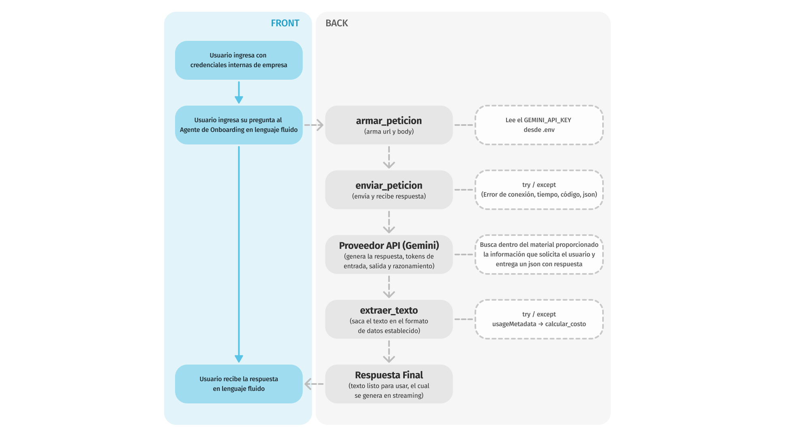
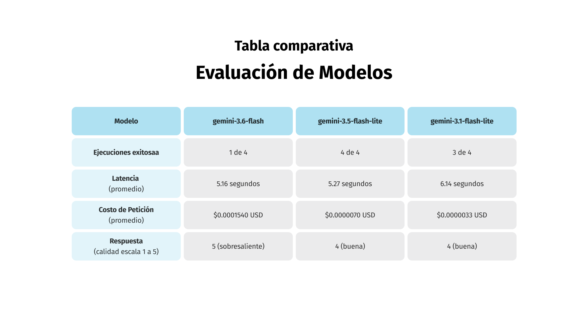

# Decisión de arquitectura: elección de modelo
  
 ## Modelo elegido
  
Para la funcionalidad de este Asistente de Onboarding se elige el modelo **gemini-3.5-flash-lite**

 ## Diagrama de arquitectura
  

El flujo de este diagrama se separa entre el font y el back, detallando aquellas instancias en que el usuario se relaciona con el front (LogIn, Ingresar pregunta, Recibir respuesta) y los pasos que ocurren en el back en una primera instancia, pasando por 'armar_peticion', 'enviar_peticion', (con la credencial GEMINI_API_KEY la cual se lee desde el archivo '.env' y manejo de errores 'try/except' identificando errores de conexión, tiempo, código o el formato json), detallando el momento en que el proveedor API entra en el flujo y busca la respuesta dentro del material proporcionado, y 'extraer_texto" (que además tiene su propio manejo de errores try/except y calcula el costo a partir de usageMetadata). El diagrama completo está en 'docs/DiagramaArquitectura.png'
  
 ## Comparación de candidatos
  
Para esta comparativa se eligen los siguientes modelos:
1. gemini-3.6-flash
2. gemini-3.5-flash-lite
3. gemini-3.1-flash-lite

Para comparar los factores de costo, latencia y calidad se utiliza la siguiente pregunta genérica relacionada al tema:
**Define qué es el proceso de onboarding en una empresa en exactamente una oración.**

El resumen de promedios de cada modelo es el siguiente

Para ver el detalle de cada modelo, revisar los siguientes archivos:
gemini-3.6-flash está en 'docs/DetalleModelo01.png'
gemini-3.5-flash-lite está en 'docs/DetalleModelo02.png'
gemini-3.1-flash-lite está en 'docs/DetalleModelo03.png'

 ## Justificación

La elección del modelo **gemini-3.5-flash-lite** radica en ser el que presenta mayor estabilidad. Sus 4 ejecuciones se realizacon con éxito, su latencia está en un nivel intermedio entre los 3 modelos, la calidad de su respuesta es buena y el costo es bastante bajo, si bien el costo es un poco mas del doble que otro modelo, la calidad de respuesta y estabilidad en los tiempos de latencia hacen que el costo observado no sea de mayor relevancia frente a la experiencia de los usuarios que van a interactuar con él.
  
 ## Alternativa descartada y por qué

 El modelo **gemini-3.6-flash** es el que tiene la respuesta más sobresaliente, pero contiene 2 factores relevantes para ser descartado: por una parte tenemos las ejecuciones exitosas, en este caso la tasa fue de un 25% (1 de 4) haciendo que las probabilidades de caída de este modelo ya sea por consumo de tokens o por exceso de demanda, y también es relevante que el valor de la muestra el ejemplo, que si bien la base de precio es 2 veces más cara que gemini 3.5 flash lite, el costo real se disparó a cerca de 22 veces más (la cual podría ser por historial previo acumulado, acumulando tokens de intentos previos o retuvo mensajes de prueba anteriores).
 En cuanto al modelo **gemini-3.1-flash-lite** se quiso probar con uno que fuera más antiguo para abaratar costos, y si bien efectivamente es aquel modelo en que el costo es menor, también tiene 2 factores relevantes para ser descartado: tuvo una tasa de ejecución exitosa de 75% (3 de 4) lo cual es menor al 100% del modelo seleccionado, es importante que la tasa de respuesta sea eficiente para que los nuevos colaboradores tengan las respuestas necesarias y de forma oportuna, además el motivo por el cual no obtuvo respuesta no fue un error declarado, sino que el tiempo de respuesta excedió el establecido; por otro lado, esto se vincula directamente con la prueba siguiente en que el tiempo de latencia fue más de 7 veces el tiempo promedio de las otras 2 ejecuciones exitosas, por lo que esta inestabilidad se considera relevante dentro de la experiencia de usuario que tendrían los colaboradores con el Asistente de Onboarding, una latencia extensa puede provocar la sensación de que el Asistente no está funcionando, está caído, o tiene errores, descartando su uso para posibles nuevas dudas que podrían ser resueltas de forma óptima por esta vía.